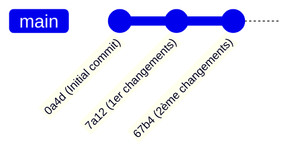
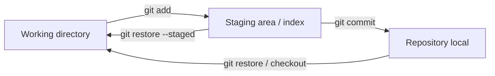
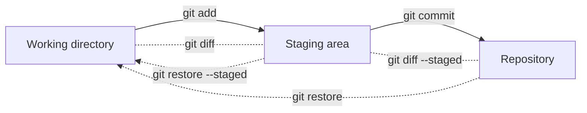
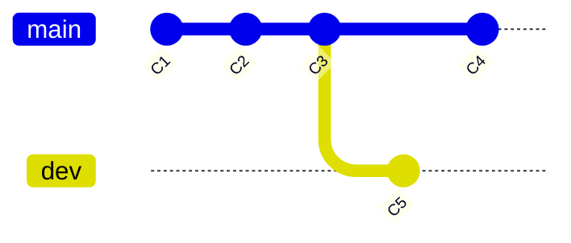
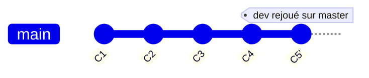
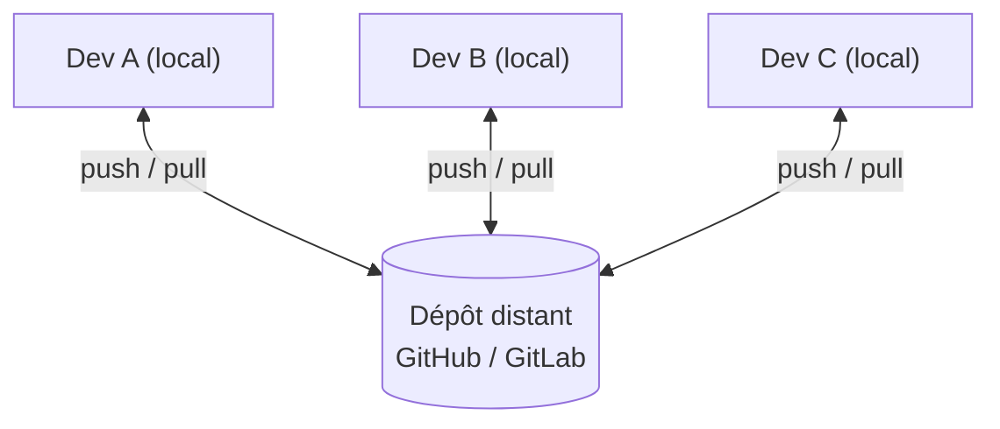
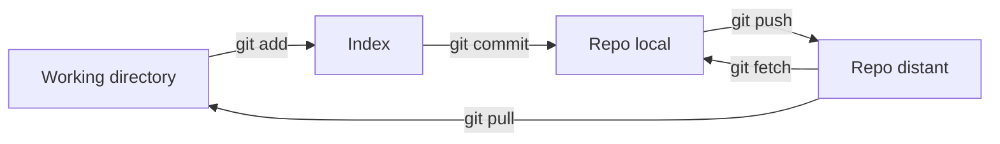
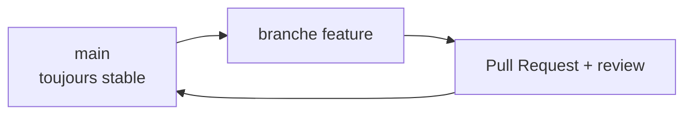

## title: Cours Git & GitHub tags: [cours, git, github, esgi, versioning] aliases: [Git, GitHub, Cours Git] cssclasses: []

# Git & GitHub : cours complet

> [!abstract] Plan du cours
> 
> 1. [1. Pourquoi versionner son code ?](#1.%20Pourquoi%20versionner%20son%20code%20%3F)
> 2. [2. Théorie : les concepts de Git](#2.%20Th%C3%A9orie%20%3A%20les%20concepts%20de%20Git)
> 3. [3. Installation et configuration](#3.%20Installation%20et%20configuration)
> 4. [4. Les commandes de base](#4.%20Les%20commandes%20de%20base)
> 5. [5. Les branches](#5.%20Les%20branches)
> 6. [6. Fusionner : merge, rebase, cherry-pick](#6.%20Fusionner%20%3A%20merge%2C%20rebase%2C%20cherry-pick)
> 7. [7. Dépôts distants](#7.%20D%C3%A9p%C3%B4ts%20distants)
> 8. [8. GitHub : travailler en équipe](#8.%20GitHub%20%3A%20travailler%20en%20%C3%A9quipe)
> 9. [9. Bonnes pratiques](#9.%20Bonnes%20pratiques)
> 10. [10. GitHub et sécurité](#10.%20GitHub%20et%20s%C3%A9curit%C3%A9)
> 11. [11. Aide-mémoire](#11.%20Aide-m%C3%A9moire)
> 12. [12. Exercices](#12.%20Exercices)

> [!info] Git ≠ GitHub
> 
> - **Git** : outil de versioning (logiciel, en ligne de commande), qui fonctionne en local.
> - **GitHub** (et GitLab, Bitbucket...) : **service d'hébergement** de dépôts Git, avec des outils de collaboration en plus (pull requests, issues, CI/CD...).

---

## 1. Pourquoi versionner son code ?

Deux objectifs principaux :

- **Garder un historique propre** de toutes les modifications : le travail est organisé en **commits** documentés.
- **Travailler à plusieurs sans se marcher dessus** : indispensable pour les projets en équipe.

Autres avantages :

- Revenir à une version antérieure qui fonctionnait.
- Tester une idée sans risque (dans une branche).
- Savoir **qui** a modifié **quoi**, **quand** et **pourquoi**.
- Sauvegarder son code sur un serveur distant.

---

## 2. Théorie : les concepts de Git

### 2.1 Le repository (dépôt)

- Un **repository Git** est un dossier dont l'historique est suivi (dossier caché `.git/`).
- Chaque repository est **autonome** (un sur chaque PC par exemple) : Git est un système **décentralisé**.
- Les repositories **échangent des données par synchronisation**, qui n'est **pas automatique** (`push`, `pull`, `fetch`).

### 2.2 Le commit

Un **commit** = un ensemble de modifications sur un ou plusieurs fichiers.

Concrètement, c'est :

- un **index** listant tous les fichiers ajoutés, modifiés ou supprimés ;
- des **métadonnées** : message (titre), auteur, date de création, hash...

Chaque commit possède un **identifiant unique** : le **SHA-1** (ex. `0a4d...`).

Les commits sont **liés les uns aux autres** et forment un historique :



### 2.3 Les 3 zones de Git

> [!tip] « 3 zones, 3 ambiances » Les modifications sont sauvegardées **3 fois**, dans 3 espaces différents.

|Zone|Rôle|
|---|---|
|**Working directory**|Zone de travail où se trouvent tous vos fichiers|
|**Staging area** (index)|Stocke les modifications **sélectionnées** en vue d'être commitées|
|**Repository**|Code **commité** (versionné) dans le Git local|



---

## 3. Installation et configuration

### 3.1 Installation

- **Windows / macOS** : [https://git-scm.com/downloads](https://git-scm.com/downloads)
- **Linux**
    - Ubuntu / Debian : `sudo apt install git gitk`
    - CentOS / RedHat : `sudo yum install git gitk`

Vérifier : `git --version`

### 3.2 Configuration minimale

```bash
git config --global user.name "Prénom Nom"
git config --global user.email "mon.email@exemple.com"
```

> [!note] Options utiles
> 
> ```bash
> git config --global init.defaultBranch main   # nom de la branche par défaut
> git config --global core.editor "nano"        # éditeur des messages de commit
> git config --list                             # voir la config
> ```

> [!warning] master vs main Le support de cours utilise **master** (ancien nom). GitHub utilise **main** par défaut depuis 2020. Les commandes sont identiques, seul le nom change.

---

## 4. Les commandes de base

### 4.1 Créer un repository

```bash
mkdir mon_code && cd mon_code
pwd
git init
# Initialized empty Git repository in .git/
```

### 4.2 Aller jusqu'au commit

**Étape 1 : créer un fichier et regarder l'état**

```bash
nano mon_fichier.txt        # ajouter 10 lignes de texte
git status
```

```text
On branch master
Untracked files:
	mon_fichier.txt
```

**Étape 2 : ajouter à la staging area**

```bash
git add mon_fichier.txt
git status
```

```text
Changes to be committed:
	new file:   mon_fichier.txt
```

**Étape 3 : versionner (commit)**

```bash
git commit                  # ouvre l'éditeur pour le message
git commit -m "Ajout de mon_fichier.txt"   # message en une ligne
git status
# nothing to commit, working tree clean
```

> [!tip] Raccourcis
> 
> - `git add -A` (ou `git add .`) : tout ajouter
> - `git commit -am "msg"` : add + commit des fichiers **déjà suivis** (ne prend pas les nouveaux fichiers)

### 4.3 Visualiser l'historique

```bash
git log                     # historique complet
git log --oneline           # une ligne par commit
git log --oneline --graph --all   # avec le graphe des branches
gitk                        # interface graphique
```

### 4.4 Voir les différences

```bash
git diff                    # working directory  vs  index
git diff --staged           # index  vs  dernier commit
```

Exemple de sortie :

```diff
--- a/mon_fichier.txt
+++ b/mon_fichier.txt
@@ -0,0 +1,4 @@
+ligne1
+ligne2
+ligne3
+ligne4
```

`+` = ligne ajoutée, `-` = ligne supprimée.

### 4.5 Annuler des modifications

**Annuler les modifications d'un fichier (non indexé)**

```bash
git restore mon_fichier.txt
# ancienne commande : git checkout -- mon_fichier.txt
```

> [!danger] Irréversible `git restore` **écrase** vos modifications locales non commitées. Elles ne peuvent pas être récupérées.

**Désindexer un fichier (retirer de la staging area)**

```bash
git restore --staged mon_fichier.txt
# ancienne commande : git reset HEAD mon_fichier.txt
```

La modification reste dans le working directory, mais n'est plus prévue pour le prochain commit.

### 4.6 Récapitulatif des commandes locales



### 4.7 Supprimer / renommer

```bash
git rm fichier.txt          # supprime + indexe la suppression
git mv ancien.txt nouveau.txt
```

### 4.8 Le fichier `.gitignore`

Liste les fichiers/dossiers que Git doit **ignorer** (jamais versionnés).

```gitignore
# dépendances
node_modules/
# build
dist/
*.log
# secrets
.env
# système
.DS_Store
```

> [!warning] Important `.gitignore` n'agit que sur les fichiers **pas encore suivis**. Pour un fichier déjà commité : `git rm --cached fichier`.

### 4.9 `git revert` : annuler un commit proprement

```bash
git revert <sha1>
```

Crée un **nouveau commit** qui annule les changements d'un commit précédent, **sans réécrire l'historique**. C'est la méthode sûre pour annuler un commit déjà poussé.

### 4.10 `git stash` : mettre de côté

```bash
git stash            # met de côté les modifs en cours
git stash list
git stash pop        # les récupère
```

Pratique pour changer de branche sans commiter un travail inachevé.

---

## 5. Les branches

### 5.1 Principe

- Une **branche** est un **pointeur vers un commit**.
- La branche principale s'appelle **master** (ou **main**).
- **HEAD** désigne la **branche courante** (là où on se trouve).
- En général : **une branche par fonctionnalité** en cours de développement.



### 5.2 Commandes

```bash
git branch                  # liste les branches
git branch dev              # crée la branche dev
git checkout dev            # déplace HEAD vers dev
git checkout -b dev         # crée dev ET s'y place
git switch dev              # commande moderne (équivalent checkout)
git switch -c dev           # crée + bascule (moderne)
git branch -d dev           # supprime une branche (déjà fusionnée)
git branch -D dev           # force la suppression
```

### 5.3 Déplacer une branche : `git reset`

```bash
git reset --soft  <sha1>    # déplace la branche ; garde index ET working directory
git reset --mixed <sha1>    # (défaut) déplace + vide l'index ; garde le working directory
git reset --hard  <sha1>    # déplace + écrase index ET working directory
```

|Option|Repository|Staging area|Working directory|
|---|:-:|:-:|:-:|
|`--soft`|modifié|conservé|conservé|
|`--mixed`|modifié|réinitialisé|conservé|
|`--hard`|modifié|réinitialisé|**écrasé**|

> [!danger] `--hard` Peut faire **perdre du travail non commité**. Ne jamais faire de `reset` sur des commits déjà partagés (utiliser `revert`).

---

## 6. Fusionner : merge, rebase, cherry-pick

Scénario de départ : `master` et `dev` ont divergé.

### 6.1 Merge

**Merge** = intégrer les modifications d'une branche **dans la branche courante**.

```bash
git checkout master
git merge dev
```

Usage typique : merger le code de développement dans la branche « officielle ».

- Si l'historique est linéaire → **fast-forward** (simple déplacement du pointeur).
- Sinon → création d'un **commit de merge**.

### 6.2 Gestion des conflits (merge)

Un conflit survient quand **les mêmes lignes** ont été modifiées différemment. Git ne sait pas choisir : **intervention manuelle**.

```text
Auto-merging fichier.txt
CONFLICT (content): Merge conflict in fichier.txt
Automatic merge failed; fix conflicts and then commit the result.
```

Dans le fichier, Git place des marqueurs :

```text
<<<<<<< HEAD
    /* lignes de la branche courante */
=======
    /* lignes de la branche fusionnée */
>>>>>>> dev
```

**Résolution :**

```bash
git status                  # repère les "both modified"
nano fichier.txt            # on garde le bon contenu, on supprime les marqueurs
git add fichier.txt
git commit
```

> [!tip] Abandonner `git merge --abort` annule la fusion et revient à l'état d'avant.

### 6.3 Rebase

**Rebase** = repositionner ses commits **par-dessus** une autre branche, pour un historique linéaire.

```bash
git checkout dev
git rebase master
```



> [!warning] Conflits lors d'un rebase Git rejoue les commits **un par un** : un conflit peut apparaître **à chaque commit**.
> 
> ```bash
> git rebase master
> # conflit sur le 1er commit !
> nano fichier.txt
> git add fichier.txt
> git rebase --continue
> # conflit sur le 2ème commit...
> git rebase --abort   # pour tout annuler
> ```

> [!danger] Règle d'or **Ne jamais rebaser une branche déjà poussée et partagée** : le rebase réécrit les commits (nouveaux SHA).

||Merge|Rebase|
|---|---|---|
|Historique|Conserve la vraie chronologie|Linéaire, « propre »|
|Commit supplémentaire|Oui (commit de merge)|Non|
|Risque|Faible|Réécrit l'historique|

### 6.4 Cherry-pick

Récupère **un seul commit** d'une autre branche et l'applique sur la branche courante.

```bash
git checkout master
git cherry-pick <sha1>
```

Le commit est copié (nouveau SHA : `C4'`).

---

## 7. Dépôts distants

### 7.1 Principe

Un **dépôt distant** est un repository hébergé sur un serveur pour le **travail collaboratif**. Les plus connus : **GitHub** et **GitLab**.

- Le repo distant joue le rôle de « **serveur** ».
- Chaque développeur possède une **copie locale** (un **clone**).
- La synchronisation se fait par **commandes** (pas automatique).



### 7.2 Protocoles

Git peut fonctionner au-dessus de :

- le protocole **Git** ;
- **HTTPS** : `https://github.com/user/repo.git` ;
- **SSH** : `git@github.com:user/repo.git`.

### 7.3 Cloner

```bash
git clone <url du repository distant>
```

### 7.4 Gérer les remotes

```bash
git remote                  # liste (origin par défaut)
git remote -v               # avec les URL (fetch / push)
git remote add origin <url> # ajoute un remote
git remote remove origin    # supprime
```

Lors d'un `clone`, Git crée automatiquement un remote nommé **origin**.

### 7.5 Branches distantes

```bash
git branch -a
# * master
#   remotes/origin/master
```

Les branches distantes sont préfixées par `remotes/<nom_du_remote>/`.

### 7.6 fetch, pull, push

```bash
git fetch        # récupère les commits distants, NE MODIFIE PAS les branches locales
git pull         # = git fetch + git merge
git pull -r      # = git fetch + git rebase
git push         # envoie les commits locaux vers le distant
```

> [!note] À retenir
> 
> - `git push` n'envoie que les commits **locaux inexistants** sur le serveur.
> - Les commits distants en plus **ne sont pas effacés**.
> - Si le distant a de l'avance, le `push` est refusé : il faut d'abord `pull`.

Première fois sur une nouvelle branche :

```bash
git push -u origin ma_branche     # -u : lie la branche locale à la distante
```

### 7.7 Schéma global



---

## 8. GitHub : travailler en équipe

### 8.1 Créer un compte et un repository

1. Créer un compte sur [https://github.com](https://github.com/).
2. **New repository** : nom, description, **public / privé**.
3. Options à l'initialisation : **README**, **.gitignore**, **licence**.

**Deux cas :**

```bash
# Cas 1 : le projet existe déjà sur GitHub
git clone https://github.com/user/repo.git

# Cas 2 : le projet existe en local
git init
git remote add origin https://github.com/user/repo.git
git branch -M main
git push -u origin main
```

### 8.2 S'authentifier

|Méthode|Remarque|
|---|---|
|**HTTPS + token (PAT)**|Le mot de passe n'est plus accepté : on utilise un _Personal Access Token_|
|**SSH** (recommandé)|Une clé par machine, pas de saisie répétée|

**Mise en place SSH :**

```bash
ssh-keygen -t ed25519 -C "mon.email@exemple.com"
cat ~/.ssh/id_ed25519.pub        # copier la clé PUBLIQUE
```

Puis : GitHub → **Settings → SSH and GPG keys → New SSH key**.

```bash
ssh -T git@github.com            # test de connexion
```

> [!danger] Jamais la clé privée Ne partager/commiter que `*.pub`. La clé privée (`id_ed25519`) reste **secrète**.

### 8.3 Les éléments d'un repository GitHub

|Élément|Rôle|
|---|---|
|**README.md**|Page d'accueil du projet (présentation, installation, usage)|
|**LICENSE**|Conditions d'utilisation du code (MIT, GPL, Apache 2.0...)|
|**.gitignore**|Fichiers à ne pas versionner|
|**Issues**|Suivi des bugs, tâches, idées|
|**Pull Requests**|Proposition de fusion + revue de code|
|**Actions**|Automatisation (CI/CD)|
|**Projects**|Tableau kanban de gestion de projet|
|**Wiki**|Documentation|
|**Releases / Tags**|Versions publiées|
|**Settings**|Collaborateurs, protections de branches, secrets|

### 8.4 Issues

- Une **issue** = un ticket (bug, fonctionnalité, question).
- On peut y ajouter : **labels**, **assignees**, **milestone**.
- Un commit/PR peut **fermer** une issue automatiquement :

```text
git commit -m "Corrige la validation du formulaire, fixes #42"
```

Mots-clés : `fixes #42`, `closes #42`, `resolves #42`.

### 8.5 Pull Request (PR)

> [!important] Le cœur du travail collaboratif sur GitHub Une **Pull Request** demande de **fusionner** une branche dans une autre, avec **discussion et relecture** avant.

**Workflow typique :**

```bash
git checkout -b feature/formulaire-contact
# ... développement, commits ...
git push -u origin feature/formulaire-contact
```

Puis sur GitHub :

1. Bouton **Compare & pull request**.
2. Titre + description (lier l'issue : `Closes #42`).
3. Choisir les **reviewers**.
4. Relecture, commentaires, **demandes de modifications**.
5. Les checks automatiques (tests CI) passent.
6. **Merge** de la PR.

Trois modes de merge sur GitHub :

|Mode|Effet|
|---|---|
|**Create a merge commit**|Conserve tous les commits + commit de merge|
|**Squash and merge**|Regroupe tous les commits de la PR en **un seul**|
|**Rebase and merge**|Rejoue les commits sans commit de merge|

Après le merge : supprimer la branche, puis en local :

```bash
git checkout main
git pull
git branch -d feature/formulaire-contact
```

### 8.6 Fork (contribuer à un projet qui n'est pas le sien)

1. **Fork** : copie du repo dans **votre** compte GitHub.
2. `git clone` de **votre fork**.
3. Ajouter le dépôt d'origine comme remote **upstream** :

```bash
git remote add upstream https://github.com/auteur/projet.git
git fetch upstream
git merge upstream/main          # mettre à jour son fork
```

4. Branche → commits → `push` sur votre fork → **Pull Request** vers le projet original.

### 8.7 Collaborateurs et permissions

- **Settings → Collaborators** : inviter des personnes sur un dépôt privé.
- Dans une organisation : rôles **Read / Triage / Write / Maintain / Admin**.
- **Branch protection rules** (Settings → Branches) :
    - interdire le push direct sur `main` ;
    - exiger une PR avec **X approbations** ;
    - exiger que les **checks CI** passent.

### 8.8 GitHub Actions (CI/CD)

Automatisation déclenchée par des événements (`push`, `pull_request`...). Les workflows sont des fichiers YAML dans `.github/workflows/`.

```yaml
# .github/workflows/ci.yml
name: CI
on:
  push:
    branches: [main]
  pull_request:

jobs:
  test:
    runs-on: ubuntu-latest
    steps:
      - uses: actions/checkout@v4
      - uses: actions/setup-node@v4
        with:
          node-version: 20
      - run: npm ci
      - run: npm test
```

Usages : lancer les tests, vérifier le style, builder, déployer automatiquement.

### 8.9 GitHub Pages

Héberge gratuitement un **site statique** depuis un repo : **Settings → Pages** → choisir la branche (ex. `main` ou `gh-pages`).

### 8.10 Tags et releases

```bash
git tag v1.0.0
git tag -a v1.0.0 -m "Première version stable"
git push origin v1.0.0
```

Sur GitHub, une **Release** associe un tag à des notes de version et des fichiers téléchargeables.

---

## 9. Bonnes pratiques

### 9.1 Messages de commit

- Court (≤ 50 caractères pour le titre), à l'**impératif** ou au présent, **explicite**.
- Un commit = **un changement logique**.

Convention **Conventional Commits** (très répandue) :

```text
feat: ajoute la page de connexion
fix: corrige le calcul de la TVA
docs: met à jour le README
refactor: simplifie le service d'authentification
test: ajoute les tests du panier
chore: met à jour les dépendances
```

❌ `maj`, `fix`, `truc`, `ça marche` ✅ `fix: empêche la double soumission du formulaire`

### 9.2 Stratégie de branches

**GitHub Flow** (simple, recommandé pour débuter) :



1. `main` est toujours déployable.
2. On crée une branche par fonctionnalité/correctif.
3. On ouvre une PR, on fait relire.
4. On merge dans `main`, on supprime la branche.

**Gitflow** (projets plus lourds) : `main`, `develop`, `feature/*`, `release/*`, `hotfix/*`.

Nommage conseillé : `feature/nom`, `fix/nom`, `docs/nom`.

### 9.3 Règles d'or

- **Commiter souvent**, par petites unités.
- **Pull avant de push** (et avant de commencer à travailler).
- **Ne jamais commiter** de secrets, mots de passe, `.env`, clés.
- **Ne pas commiter** les fichiers générés (`node_modules`, `dist`, `*.class`...).
- **Ne pas réécrire** l'historique partagé (`rebase`, `reset --hard`, `push --force`).
- Si force nécessaire : `git push --force-with-lease` (plus sûr que `--force`).
- Rédiger un **README** clair.

### 9.4 Bien démarrer sa journée de travail

```bash
git checkout main
git pull
git checkout -b feature/ma-tache
```

---

## 10. GitHub et sécurité

> [!warning] Pertinent pour un cursus cybersécurité Un secret commité reste dans l'**historique**, même après suppression du fichier.

### 10.1 Fuite de secrets

Si une clé API/mot de passe a été poussé :

1. **La révoquer / régénérer immédiatement** (c'est l'action prioritaire).
2. Nettoyer l'historique (`git filter-repo`, BFG Repo-Cleaner) : utile mais **insuffisant** seul.
3. Considérer que le secret est **compromis**.

**Prévention :**

- `.env` dans `.gitignore`, fichier `.env.example` sans valeurs.
- Utiliser les **GitHub Secrets** (Settings → Secrets and variables) pour les Actions.
- **Secret scanning** et **push protection** (GitHub).
- Outils : `gitleaks`, `trufflehog`.

### 10.2 Fonctionnalités de sécurité GitHub

|Fonction|Rôle|
|---|---|
|**Dependabot**|Alertes + PR de mise à jour des dépendances vulnérables|
|**Code scanning** (CodeQL)|Analyse statique du code|
|**Secret scanning**|Détecte les secrets dans le code|
|**Security policy** (`SECURITY.md`)|Explique comment signaler une vulnérabilité|
|**2FA**|Authentification à deux facteurs (à activer !)|

### 10.3 Signer ses commits

Les champs `user.name`/`user.email` sont **déclaratifs** : n'importe qui peut usurper une identité. Les commits **signés** (GPG ou SSH) affichent un badge **Verified** sur GitHub.

```bash
git config --global commit.gpgsign true
```

### 10.4 OSINT / audit

Les dépôts publics sont une source d'information : historique de commits (emails, noms), fichiers oubliés, secrets. À garder en tête côté attaque comme côté défense.

---

## 11. Aide-mémoire

### Repository

|Commande|Rôle|
|---|---|
|`git clone <url>`|Copie un dépôt distant|
|`git init`|Crée un dépôt local|

### Commit

|Commande|Rôle|
|---|---|
|`git add / rm`|Ajoute / supprime dans l'index|
|`git restore`|Annule des modifications|
|`git commit`|Versionne les changements|
|`git status`|État du dépôt|
|`git diff`|Affiche les différences|
|`git revert`|Annule un commit par un nouveau commit|

### Historique

|Commande|Rôle|
|---|---|
|`git log`|Historique|
|`gitk`|Historique en interface graphique|

### Branches

|Commande|Rôle|
|---|---|
|`git branch`|Liste / crée / supprime|
|`git checkout` / `git switch`|Change de branche|

### Manipulation de branches

|Commande|Rôle|
|---|---|
|`git reset`|Déplace la branche (`--soft/--mixed/--hard`)|
|`git merge`|Fusionne dans la branche courante|
|`git rebase`|Rejoue les commits sur une autre base|
|`git cherry-pick`|Applique un commit isolé|

### Synchronisation

|Commande|Rôle|
|---|---|
|`git remote`|Gère les dépôts distants|
|`git fetch`|Récupère sans fusionner|
|`git pull`|`fetch` + `merge` (ou `rebase` avec `-r`)|
|`git push`|Envoie les commits locaux|

### Situations courantes

|Je veux...|Commande|
|---|---|
|Annuler mes modifs non indexées|`git restore fichier`|
|Retirer un fichier de l'index|`git restore --staged fichier`|
|Corriger le dernier message de commit|`git commit --amend`|
|Annuler un commit déjà poussé|`git revert <sha1>`|
|Mettre mon travail de côté|`git stash` / `git stash pop`|
|Voir qui a écrit une ligne|`git blame fichier`|
|Trouver un commit fautif|`git bisect`|
|Récupérer un commit « perdu »|`git reflog` puis `git checkout <sha1>`|
|Abandonner un merge / rebase|`git merge --abort` / `git rebase --abort`|

> [!tip] `git reflog` Journal de tous les déplacements de HEAD : filet de sécurité pour retrouver des commits après un mauvais `reset`.

---

## 12. Exercices

### Exercice 1 : les bases en local

1. Créer un dossier, `git init`.
2. Créer `mon_fichier.txt` (10 lignes), `git status`.
3. `git add`, `git commit -m "..."`.
4. Modifier le fichier, faire `git diff`, puis `git restore`.
5. Modifier, `git add`, `git restore --staged`, `git status`.
6. Faire 3 commits et observer `git log --oneline`.

### Exercice 2 : branches et merge

1. Créer la branche `dev`, y faire 2 commits.
2. Revenir sur `master`, faire 1 commit.
3. `git merge dev` et observer `git log --oneline --graph --all`.

### Exercice 3 : provoquer et résoudre un conflit

1. Sur `master` et sur `dev`, modifier **la même ligne** d'un fichier différemment.
2. `git merge dev` → conflit.
3. Résoudre à la main, `git add`, `git commit`.
4. Refaire l'exercice avec `git rebase` et comparer.

### Exercice 4 : GitHub

1. Créer un repo sur GitHub avec un README.
2. Configurer une clé SSH.
3. `git clone`, créer une branche `feature/test`, commit, `git push -u origin feature/test`.
4. Ouvrir une **Pull Request**, la merger (squash).
5. `git pull` sur `main` en local, supprimer la branche.

### Exercice 5 : travail en binôme

1. Un binôme crée le repo et invite l'autre en collaborateur.
2. Chacun crée sa branche, modifie le **même fichier**.
3. Chacun ouvre une PR : la 2ème PR va générer un **conflit** à résoudre.
4. Faire relire la PR de l'autre (commentaires, approbation).

### Exercice 6 : automatisation

1. Ajouter un workflow GitHub Actions qui lance un test à chaque `push`.
2. Activer la **branch protection** sur `main` pour exiger que le check passe.

---

> [!quote] Pour retenir **add** → **commit** → **push**, et toujours **pull** avant de commencer. Une branche par tâche, une PR pour relire, `main` toujours propre.

#git #github #cours