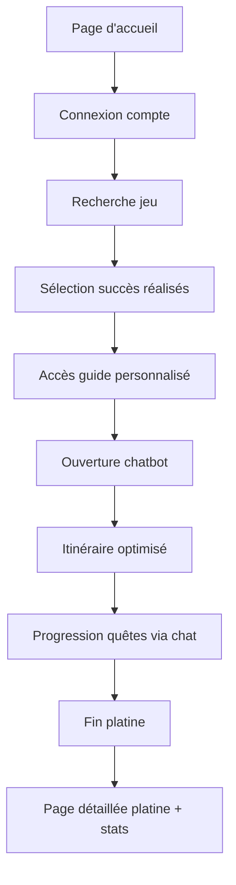
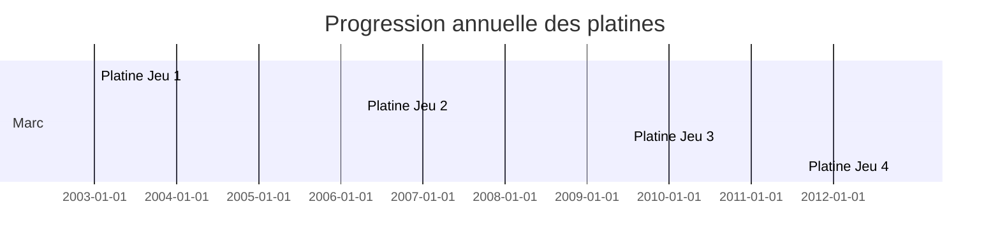
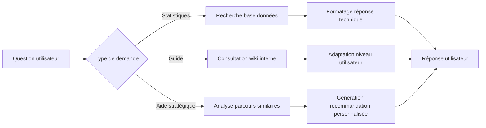

# 🎮 Projet IHM 2 : Conception d'Interface Adaptative pour Plateforme de Gaming

> [!info] Contexte du projet
> Ce projet vise à concevoir une interface adaptative pour une plateforme de gaming, en répondant aux besoins spécifiques de différents profils d'utilisateurs identifiés à travers des personas : Marc (joueur expert compétitif), Léa (joueuse occasionnelle sociale) et Sofiane (joueur analytique méthodique).

## 👥 Personas cibles

Avant de détailler les exigences, voici les trois personas pour lesquels cette interface est conçue :

| Persona | Profil | Motivation principale | Frustration principale |
|---------|--------|----------------------|------------------------|
| **Marc** | Joueur expert compétitif | Optimisation, performance, reconnaissance | Interfaces trop simplifiées, manque de données avancées |
| **Léa** | Joueuse occasionnelle sociale | Plaisir, partage, progression gratifiante | Complexité excessive, interfaces austères |
| **Sofiane** | Joueur analytique méthodique | Compréhension, optimisation systématique, efficacité | Données peu fiables, manque de transparence |

## 📋 Exigences identifiées

### 1. Exigences ergonomiques
Permettent une utilisation efficace, sûre et confortable de l'interface.

### 2. Exigences expérientielles (UX)
Portent sur les aspects émotionnels, sociaux et ludiques de l'expérience utilisateur.

## 🔧 Les 15 exigences détaillées

### 1. Affichage adaptable à la densité d'information
> **Mode dense/tableur** pour Marc (« taux de rareté mondial, temps moyen »)  
> **Mode visuel allégé** pour Léa (« pas austère comme un tableur »)  
> → _Critère d'adaptabilité_  
> **Implémentation** : Possibilité de choisir les informations importantes à afficher selon le profil utilisateur.

### 2. Centralisation des ressources
Regrouper stats, guides et walkthroughs au même endroit pour éviter le jonglage entre sites (Marc : PSNProfiles, PowerPixel, Reddit en simultané)  
→ _Regroupement/distinction_

### 3. Fraîcheur et fiabilité des données
Mise à jour rapide après chaque patch, sous peine de perte de confiance définitive  
(Marc : « une erreur de guide et je ne reviens plus » ; Sofiane : estimations de temps peu fiables)  
→ _Fiabilité_

### 4. Guidage explicite avec alertes de non-retour
Signaler en amont les trophées ratables et points de bascule (Marc, et la timeline de Léa)  
→ _Guidage/prévention des erreurs_

### 5. Adaptabilité du langage de l'assistant
Réponses techniques et brèves pour un expert (Marc)  
Résumés simples sans jargon pour un joueur occasionnel (Léa)  
→ _Adaptabilité au profil_

### 6. Explicabilité des recommandations
Justifier le « pourquoi » d'un ordre plutôt que l'imposer arbitrairement (Sofiane)  
→ _Signifiance/transparence_

### 7. Tableau de bord à KPIs avancés
Temps investi vs estimé, difficulté perçue vs officielle, répartition par genre, comparaison au classement mondial (Marc, Sofiane)  
→ _Richesse informationnelle_

### 8. Valorisation visuelle de la collection
Badges stylisés, vitrine par jeu plutôt que chiffres froids (Léa)  
→ _Gratification esthétique_

### 9. Visualisation temporelle de la progression
Graphique d'évolution annuelle des platines (Marc)  
→ _Lisibilité des données longitudinales_

### 10. Timeline visuelle par étapes
Remplacer les pavés de texte techniques par des étapes illustrées (Léa)  
→ _Hiérarchisation visuelle_

### 11. Export soigné et partageable
Rendu graphique propre pour réseaux sociaux, pas un screenshot brut (Léa)  
→ _Habillage du partage_

### 12. Classement social multi-critères
Trash-talk sur la rareté (Marc) vs comparaison d'efficacité méthodique (Sofiane) : deux logiques de classement à concilier  
→ _Dimension compétitive différenciée_

### 13. Aide à la décision en amont
Taux de complétion, difficulté et temps estimé visibles dès la fiche du jeu, avant même de l'acheter (Léa, Sofiane)  
→ _Accessibilité des données de synthèse_

### 14. Recommandations évolutives / apprenantes
Un assistant qui affine l'ordre optimal à partir des parcours réels d'autres joueurs plutôt qu'un guide statique (Sofiane)  
→ _Personnalisation progressive_

### 15. Gamification et engagement ludique
Défis mensuels et mécaniques de jeu dans le suivi lui-même, au-delà du simple outil (Léa)  
→ _Dimension motivationnelle expérientielle_

## 👤 Scénario utilisateur : Parcours de Marc

**Il arrive sur la page d'accueil**  
→ Il se connecte à sa page compte et accède à son dashboard  
→ Il tape le nom du jeu qu'il est en train de platiner  
→ La liste des succès apparaît et il sélectionne tout ce qu'il a déjà fait sur ce qui n'a pas encore été enregistré  
→ Il accède au guide détaillé complet avec modification personnalisé (rainur sur les noms des quêtes déjà complétées) pour continuer sa quête  
→ Il ouvre la fenêtre de chatbot qui lui donne son point de départ sur la map  
→ Le chatbot lui propose un résumé des informations du guide afin qu'il ait une route optimale  
→ Il avance sur ses quêtes en chatant avec le chatbot qui va autocompléter les quêtes sur les sites afin de les ajouter à son compte  
→ Il termine complètement son platine, le bot le félicite et le renvoie sur la page détaillée du platine où il a des stats en rapport avec ceci (rareté du platine, % de gens qui l'ont actuellement sur la plateforme, etc.)

## 🎨 Recommandations de conception visuelle

### Flux utilisateur et wireflow
> **Notion importante** : UserFlow et wireFlow (à définir) - mettre un schéma explicatif en plus si possible

### Palette de couleurs
- **Bonnes pratiques** : Utiliser limité 2/3 couleurs principales  
- **Stratégie complémentaire** : Analogues Monochromatique (faire un tableau qui explique)  
- **Outils** : colors.co  
- **Accessibilité** : Assurer un contraste suffisant pour la fiabilité et l'accessibilité (ratio 4.5:1 minimum)

### Prototypes vs Maquettes
- **Basse fidélité** jusqu'à **haute fidélité**  
- **Différence** : Un prototype est testable et fonctionnel, une maquette est statique et illustrative

## 📈 Schémas et visualisations recommandés

Bien que ce fichier soit en format Markdown, voici les schémas qui devraient être créés en complément (en tant que fichiers image ou diagrams Mermaid) :

### 1. Diagramme de flux utilisateur (User Flow)

### 2. Tableau d'adaptabilité de l'affichage
| Critère | Marc (Expert) | Léa (Occasionnelle) | Sofiane (Analytique) |
|---------|---------------|---------------------|----------------------|
| Niveau de détail | Maximal (stats avancées) | Modéré (essentiels) | Équilibré + métadonnées |
| Visualisation | Tableaux, graphiques | Icônes, barres simples | Tableaux + exports CSV |
| Langage | Technique, précis | Simple, accessible | méthodique, détaillé |
| Mises à jour | Temps réel | Périodiques | Avec historique |

### 3. Timeline de progression annuelle

### 4. Diagramme des flux de décision du chatbot

## 🔗 Liens associés
- [[IHM - Interfaces Homme-Machine]]
- [[UCD - User-Centered Design]]
- [[Personas gaming]]
- [[Prototypage IHM]]
- [[Tests utilisabilité]]

## 📚 À retenir
1. Une bonne IHM s'adapte aux **profils utilisateurs** variés plutôt qu'imposant une solution unique
2. La **fiabilité des données** est cruciale pour maintenir la confiance des utilisateurs experts
3. La **personnalisation progressive** améliore l'engagement à long terme
4. L'**export partageable** renforce l'aspect social de l'expérience gaming
5. La **gamification du suivi** augmente la motivation et la fidélisation

> [!NOTE] Prochaines étapes
> - Créer les schematics/visualisations mentionnées ci-dessus
> - Développer des prototypes à différentes fidelités
> - Conduire des tests utilisabilité avec les personas représentatifs
> - Itérer basé sur les retours utilisateurs