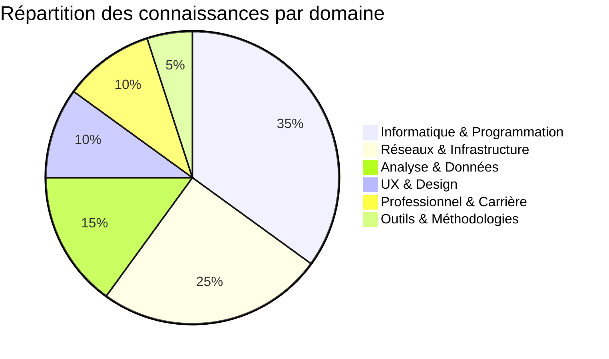

# 🏠 Homme - Tableau de Bord Central

> [!welcome] Bienvenue dans votre vault ESGI
> Ce tableau de bord sert de point d'entrée central pour naviguer à travers toutes vos notes, cours et projets organisés par matière et par thème.

## 📊 Vue d'ensemble du vault

| Statistique | Détail |
|-------------|--------|
| **Matières principales** | 11 domaines d'étude |
| **Fichiers markdown** | ~150+ notes organisées |
| **Dernière mise à jour** | Aujourd'hui |
| **Objectif** | Centraliser tous vos apprentissages ESGI |

## 🎯 Accès rapide par domaine

### 💻 Informatique & Programmation
- [[Algorithmes - Algo/]] - Cours d'algorithmie et Python
- [[Langage C - Language C/]] - Programmation système en C
- [[Git & GitHub - GitHub/]] - Gestion de version et collaboration

### 🌐 Réseaux & Infrastructure
- [[Architecture réseau - Architecture/]] - Cours complet sur les réseaux
- [[OSINT - OSINT/]] - Recherche ouverte et renseignements
- [[Réseaux - Réseaux/]] - Communications et protocoles

### 📊 Analyse & Données
- [[Modélisation de données - Modélisation/]] - Conception de bases de données
- [[Statistiques & Analyse]] - À venir
- [[Machine Learning]] - À venir

### 👥 Relations Humaines & Professionnelles
- [[UX & Design - UX/]] - Expérience utilisateur et design
- [[Resources humaines - Professionnel/]] - Carrière et alternance
- [[Communication]] - À venir

### 🛠️ Outils & Méthodologies
- [[Méthodes de travail]] -À venir
- [[Outils de développement]] -À venir
- [[Méthodologie de projet]] -À venir

## 📚 Dernières mises à jour

### 🔥 Cette semaine
- [Projet modélisation base de données](../Mod%C3%A9lisation/Projet%20mod%C3%A9lisation%20base%20de%20donn%C3%A9es.md) - Nouveau cours complet sur la modélisation
- [IHM 2 - Modélisation/IHM 2](../Mod%C3%A9lisation/IHM%202.md) - Projet d'interface adaptative pour gamers
- [Entreprises IT - Professionnel/Entreprises IT](Entreprises%20IT.md) - Guide des alternances à Toulouse

### 📖 À réviser
- [Les Fonctions - Algo/Cours/Les Fonctions.md](../Algo/Cours/Les%20Fonctions.md) - Programmation fonctionnelle
- [00 - Index - Architecture/00 - Index.md](../Architecture/00%20-%20Index.md) - Index des réseaux
- [UCD - UX/UCD.md](../UX/UCD.md) - User-Centered Design

## 🧩 Connexions transversales

> [!info] Comment utiliser ce tableau de bord
> Ce fichier sert de **nœud central** dans votre graphe de connaissances. Chaque lien ci-dessous crée une connexion bidirectionnelle qui enrichit votre réseau de connaissances Obsidian.

### Liens transversaux suggérés
- [[Algorithmes]] ↔ [[Modélisation de données]] (optimisation)
- [[Réseaux]] ↔ [[OSINT]] (sécurité réseau)
- [[UX]] ↔ [[Git & GitHub]] (collaboration en design)
- [[Professionnel]] ↔ [[Git & GitHub]] (portfolio technique)

## 🚀 Actions rapides

### Créer une nouvelle note
1. Choisissez le dossier approprié ci-dessus
2. Utilisez le modèle de cours ou de projet selon le contexte
3. N'oubliez pas de linker vers cette page d'accueil

### Revue hebdomadaire recommandée
- [ ] Parcourir les nouvelles notes de la semaine
- [ ] Vérifier les liens orphelins
- [ ] Mettre à jour le tableau de bord si nécessaire
- [ ] Identifier les sujets à approfondir

## 📈 Évolution du vault

## 🔗 Navigation principale

### Retour à l'accueil
Ce lien vous ramène toujours à ce tableau de bord depuis n'importe où dans votre vault.

### Explorez par matière
Cliquez sur un domaine ci-dessus pour voir toutes les notes associées, ou utilisez la recherche Obsidian (Ctrl+O) pour trouver des notes spécifiques.

---

> [!NOTE] Dernière pensée
> Votre connaissance est un réseau, pas une hiérarchie. Chaque note que vous créez renforce les connexions existantes et en crée de nouvelles. Utilisez les liens `[[...]]` liberally pour tisser votre toile de savoir.

> [!TIP] Astuce de puissance
> Utilisez la vue graphe d'Obsidian pour voir comment vos connaissances s'interconnectent et découvrez des associations inattendues entre des sujets apparemment éloignés.

---
*Mis à jour le {{date:YYYY-MM-DD}} - Votre portail personnel de connaissance ESGI*